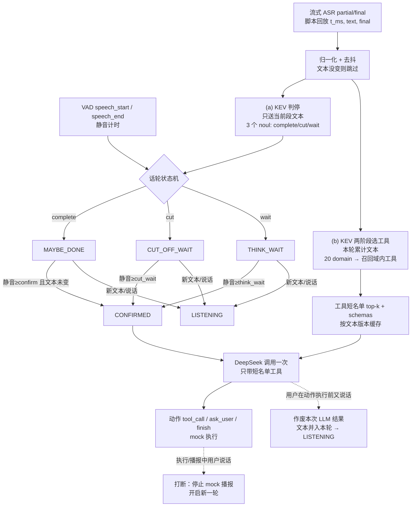

# 流式 ASR × KEV 判停 + 选工具 → DeepSeek 单次决策：PoC 扩展设计

> 2026-10-15 · 基于现有 PoC（`jev-research/poc-ui/server.py` → checkout `jev-reopt-checkouts/dev-20261013` @ `fb5b259`，`eval/core_pipeline_run.py`）。
> 数据来源标注：**[实测]** = 今日或 10-14 的已有报告；**[假设]** = 未测量，需 M2/M3 验证。

## 1. 目标与非目标

**目标**：ASR 每次 partial/final 更新都用 KEV 做“说完没”三态判断（complete / cut-off / needs-time），同时用 KEV 两阶段（domain→tool）选出工具短名单；话轮确认后 **只调用一次** DeepSeek（`deepseek-v4.1-flash`，公司 LiteLLM）给出下一步动作。先把核心链路端到端跑通并能在 UI 上看清每次更新的分数和时间。

**非目标（本阶段砍掉）**：真实麦克风流式 ASR 接入（M1 用“脚本化 ASR 更新回放”代替，现 PoC 本身是 `asr: text_standin`）；TTS；真实工具执行（保持 `mock_only`）；音频判停模型（Smart Turn 类）；多会话并发、重连、鉴权、KEV 隧道容灾；车端部署。

## 2. 目标流程

两条 KEV 调用 **并行**，状态机只依赖 (a)；(b) 的结果在 CONFIRMED 时被取用。关键路径 = max(判停+确认窗, 选工具)，再加 LLM。

## 3. 决策规则

**3.1 判停输入与问题**（沿用今日最佳配置 R2：英文标签、只送当前话语、无对话上下文、argmax）
- `state = {"utterance": <当前段文本>}`；三个 noul 问题的 instructions 原样复制 `pipecat-turn-eval-v2/kev_tune2.py` 中 `r2_en_utter_only`。
- “当前段”= 本轮最后一个 ASR 段（partial 或 final）。若该段很短（<4 字 [假设]）则拼上前一段。段 vs 本轮累计全文作为 `eot_input` 配置项，M2 两种都测。
- 选工具用本轮累计全文（与现有 `score_multidomain(snapshot, utterance, context)` 一致）。

**3.2 阈值**
- 基线：argmax(complete, cut, wait)。[实测] 留出集二分类 94.6%、三分类 97.4%。
- margin 选项：判 complete 需 `complete − max(cut, wait) ≥ m`。下表是 R2 在 **全部 168 轮** 上的描述性统计（不是留出集，仅用来定初值）：

| m | 误判说完（/93 未说完） | 漏判说完（/75 说完） |
|---|---|---|
| 0（argmax） | 11 | 0 |
| 0.1 | 10 | 4 |
| 0.2 | 6 | 10 |
| 0.3 | 3 | 21 |

  → 初值：确认用 `m=0`（误判由静音窗兜底）；投机启动 LLM 用 `m_spec=0.3`（误触少，但只覆盖大约 72% 的说完轮次）。

**3.3 计时器**（均为 [假设] 初值，从“最后一次文本变化”与 VAD `speech_end` 中较晚者开始算静音）
- `confirm_silence_ms=300`：MAYBE_DONE 后静音达到即 CONFIRMED。
- `cut_wait_ms=1500`：判 cut-off 时多等，到时仍强制 CONFIRMED（交给 LLM，必要时 ask_user），不让会话卡住。
- `think_wait_ms=3000`：用户说“等一下/我想想”，不调 LLM，到时再 CONFIRMED。
- `max_silence_ms=2000`：不管 KEV 给什么，只要静音达到就 CONFIRMED（KEV 失败或超时 >400ms 也走这条）。现有 `jev_voice/audio.py` 中 `VADConfig.end_silence_ms=550` 可作对照。
- 纯文本无法区分“我去买菜”和“我去买菜，对了还要买酱油”：前半句 KEV 很可能判 complete，靠静音窗和下面的“反转”规则兜底。

**3.4 反转与取消**
- 每个 ASR 更新带单调递增的 `text_version`；KEV/LLM 结果只在版本仍是最新时生效，否则丢弃（记 `stale`）。
- MAYBE_DONE/CUT/THINK 状态下来了新文本或 VAD `speech_start` → 回到 LISTENING，取消计时器；有投机 LLM 在途则作废（`llm_cancel`）。
- CONFIRMED 后、动作执行前用户又开口（如“对了还要买酱油”）→ 作废在途 LLM，新文本并入本轮，回到 LISTENING；合并后再确认时仍只做一次有效决策。动作已执行（mock）或播报中再开口 → 视为打断：停止播报，开启新一轮，不回滚。
- 取消的实现：现 `slow_turn()` 是同步、`stream: False`，PoC 里“取消”= 放弃该线程的结果（token 照样消耗），不改模型客户端。

**3.5 去抖与限流**
- 文本归一化（去标点和空白）后与上次相同 → 不调用（`eot_skipped: unchanged`）。
- `debounce_ms=80` [假设]：80ms 内的连续 partial 只保留最后一条。
- 每类 KEV 调用同一时刻最多在途 1 个；在途期间到来的更新只保留最新一条作为 pending，返回后立即补发（合并请求）。
- 判停用独立 HTTP Client（`KEV_EOT_CLIENT`，1 连接），不和选工具的 `KEV_MD_CLIENT`（2 连接）抢连接；服务端是否互相拖慢没测过（见风险）。

## 4. 延迟预算（t=0 为用户最后一个字结束）

| 环节 | 数值 | 来源 |
|---|---|---|
| 流式 ASR 出最终文本 A | 150–300ms | [假设]，PoC 尚无真实流式 ASR |
| KEV 判停（单次） | 平均 160 / 中位 152 / p90 181ms 墙钟；模型自报约 49ms，其余约 110ms 是 SSH 隧道往返；每轮 >300ms 尖刺 0–3 次 | [实测] pipecat-turn-eval-v2 R2 |
| 确认静音窗 | 300ms，与判停并行 | [假设] |
| KEV 选工具：导航 14 工具单请求 | p50 221 / p95 496ms | [实测] KEV-200-SINGLE-VS-PARALLEL |
| KEV 选工具：两阶段 200 工具，N=1 | p50 684 / p95 738ms（阶段1 430 + 阶段2 256） | [实测] KEV-TWO-STAGE |
| KEV 选工具：阈值 0.4 多域召回（复合句） | 连续 p50 962 / p95 1330ms | [实测] KEV-THRESHOLD-RECALL §5 |
| DeepSeek 决策（PoC 非流式，导航） | ~1.38s（单次 smoke：`llm_start` 447ms → `llm_decision` 1826ms） | [实测] n=1 |
| DeepSeek TTFT（Pipecat marker prompt，thinking 关） | 平均约 1.5s，p90 约 2.5s | [实测]，prompt 与 PoC 不同 |

**估算**（多域场景，[假设] 组合，不是实测）：CONFIRMED ≈ A + max(160, 300) ≈ A+300ms；但如果最终文本触发了一次新的选工具，短名单要到 A+684ms 才有 → **LLM 启动 ≈ A+0.7s，拿到决策 ≈ A+2.1s**。注意 **在 LLM 之前，选工具（约 680ms）比判停（160ms）更慢**；整体耗时最大的是 DeepSeek。

**优化，按价值排序**
1. **在 partial 上提前选工具，最终文本归一化后不变就直接复用**：零额外 LLM 成本，最多能把约 0.7s 从关键路径上拿掉。M1 就做。
2. **投机启动 LLM**：进入 MAYBE_DONE 且 margin ≥ `m_spec` 时，用手上的短名单立即调 DeepSeek，判停反转就作废；能省掉 300ms 确认窗，并让 LLM 和选工具的尾巴重叠。代价是浪费的调用，要记录浪费率。M3 打开。
3. **缩短 prompt**：只披露 top-k 短名单 schemas（现在已是 top-3），精简 `slow_turn` 的 system prompt；收益没测过 [假设]。
4. LiteLLM `stream: true`：tool_call 要拿到完整 JSON 才能执行，收益有限；主要用于以后先播一句“好的”。暂不做。

## 5. 代码改动（都在 `dev-20261013` checkout 和 `poc-ui/` 内）

| 文件 | 改动 |
|---|---|
| `eval/core_pipeline_run.py` | 把 `run()` 拆成 `select_tools(utterance, tool_set, context) -> {scores, selected, schemas, timing}` 和 `decide(utterance, selected, schemas, tool_set, context) -> decision`；`run()` 改为依次调用这两个函数，`/api/run` 和 `/api/run/stream` 行为不变。新增 `KEV_EOT_CLIENT`。 |
| 新 `eval/turn_eot.py` | `EOT_LABELS`（R2 原文）；`score_eot(text) -> {complete, cut, wait, label, margin, wall_ms, kev_ms}`，复用 `kev_call()`、`probability()`。 |
| 新 `eval/turn_session.py` | `TurnConfig`（dataclass）与 `TurnSession`：`on_asr(t_ms, text, final)`、`on_vad(t_ms, kind)`、`tick(now)`；状态机 LISTENING / MAYBE_DONE / CONFIRMED / CUT_OFF_WAIT / THINK_WAIT；判停和选工具各自单飞 + 最新 pending；结果按 `text_version` 校验；调用 `select_tools` / `decide`；通过 `on_event` 回调输出事件；把时间线写到 `eval/evidence/turn-session/<id>/timeline.json`。 |
| `poc-ui/server.py` | 新 `POST /api/session/stream`：请求体为 `{updates:[{t_ms,text,final}], vad:[{t_ms,kind}], config:{...}, tool_set}`，按真实时间间隔回放，SSE 推送事件；旧接口保留。 |
| `poc-ui/index.html` | 新“流式模拟”模式：输入文本 + 语速（字/秒）+ 停顿标记（如 `我去买菜\|600\|对了还要买酱油`，`\|600\|` 表示停顿 600ms），自动生成 partial 更新；时间线表每行：t、文本、三项分数、argmax/margin、状态变化、KEV 墙钟/自报耗时、工具 top-3；LLM 启动/作废/决策单独标色。 |

**新配置字段**（`TurnConfig`，可由请求覆盖）：`eot_policy=argmax|margin`、`eot_margin=0.0`、`spec_margin=0.3`、`speculative_llm=false`、`eot_input=last_segment|turn_text`、`confirm_silence_ms=300`、`cut_wait_ms=1500`、`think_wait_ms=3000`、`max_silence_ms=2000`、`eot_timeout_ms=400`、`debounce_ms=80`、`reuse_tools_if_text_unchanged=true`、`tool_set=navigation|multidomain`。

**事件**：`asr_update`、`eot_start`、`eot_scores`、`eot_skipped(reason)`、`tools_start`、`tools_scores`、`state_change(from,to,why)`、`llm_start(speculative)`、`llm_cancel(reason)`、`llm_decision`、`barge_in`、`turn_done`。`turn_done` 汇总：`t_last_word`、`t_confirmed`、`t_llm_start`、`t_decision`、`eot_calls`、`eot_skipped`、`tool_calls`、`llm_calls`、`llm_wasted`。

## 6. 验证计划

**V0 回归**（半天）：用 `score_eot` 重跑 168 轮。留出集二分类须复现 94.6%（允许差 1 条），证明接入没改语义。

**V1 前缀回放：首个实验，也是最大风险。** KEV 只在整句上测过，从没在每个前缀上测过。流式时每个中间前缀都会被打分；只要某个前缀被误判为“说完”，又恰好碰上一次停顿，LLM 就会被提前触发。
- 造数据：新脚本 `eval/build_prefix_cases.py` 生成 `eval/fixtures/streaming-prefix-cases.jsonl`，每行 `{id, lang, source, full_text, prefix, idx, is_full, gold}`。
  - 中文：`eval/fixtures/tools-multidomain.yaml` 注释中的 200 句 + `core-pipeline-corpus.jsonl`，按 1–2 字切前缀；
  - 英文：`pipecat-turn-eval-v2/cases.json` 的 168 轮，按词切前缀。
  - 标签：`is_full` 取原标签；真前缀默认 `incomplete`。本身就能成句的前缀（如“导航回家吧”中的“导航回家”）由 DeepSeek 先预标为“可自然结束”，再人工抽查，统计时单列，不算误判。
- 新脚本 `eval/streaming_prefix_eval.py`：把前缀序列喂给 `TurnSession`，用虚拟时钟加停顿注入（大部分 0ms，约 20% 句中插入 400–800ms 停顿 [假设]）。
- 指标：① 前缀误判说完率（按前缀算 / 按句算“任一前缀误判”）；② 提前触发 LLM 率（误判又碰上停顿 ≥ 确认窗）；③ 最后一个字 → CONFIRMED / → LLM 启动 / → 决策的延迟；④ 每句 KEV 调用数和跳过数；⑤ 投机打开时的 LLM 浪费率。
- **通过标准** [假设，M2 后可修订]：整句二分类 ≥ 93%；提前触发 LLM 率 ≤ 5%（按句）；最后一个字 → LLM 启动中位 ≤ 800ms（复用工具时 ≤ 400ms）；每轮有效 LLM 决策恰好 1 次；投机浪费率 ≤ 30%。

**V2 端到端 smoke**：UI 跑“导航回家”、“我去买菜|600|对了还要买酱油”、“帮我导航到…|1500|…人民广场”、“等一下我想想|2500|回家”，人工核对时间线。

## 7. 风险、开放问题、里程碑

**风险**
1. 前缀误判说完（见 V1），这是第一风险。
2. KEV 判停只在英文 Pipecat 场景上调过；中文车载口语没评过。已有中文标签变体 `r6_zh_rich_utter_only` 可以对比。
3. 判停和选工具同时打同一个 KEV 服务，判停的 160ms 是串行测得的，并发下会不会变慢没测过。
4. 每 100–200ms 一次 partial，KEV 调用量较大；去抖效果待测。
5. 留出集小（50–56 条），划分方式也不一样，94.6% vs 96.4% 的差距不显著。

**开放问题**：真实流式 ASR 选哪家，partial 频率和 final 延迟是多少？判停用最后一段还是本轮全文？cut-off 超时后直接决策还是追问？

**里程碑**
- **M1 核心链路**：`/api/session/stream` + UI 时间线跑通，四个 V2 脚本都能正确演示（每轮 1 次有效决策，反转时正确作废）。完成标准：四个脚本全部正确演示。
- **M2 前缀回放评测**：完成标准：中英两套前缀数据产出 V1 全部指标的报告（含逐句明细），回答“是否达到通过标准”。
- **M3 调优**：调 margin、计时器、`eot_input`，打开投机 LLM。完成标准：找到一组满足通过标准的配置；如果达不到，写明差距和下一步（如加入音频判停模型）。
